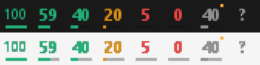

# TrayUsage

TrayUsage показывает, сколько лимита Codex осталось, прямо в трее Windows 10 и 11. Можно выбрать лимит на 5 часов или на неделю. Данные обновляются каждую минуту, а при наведении на значок видно время сброса обоих лимитов.



## Запуск

[Скачайте TrayUsage.exe](https://github.com/PavlikPromix/tray-usage/releases/latest/download/TrayUsage.exe) и запустите его. Установка не нужна. Приложение появится в трее рядом с часами; если значок скрыт, найдите его под стрелкой. Нажмите на значок правой кнопкой мыши, чтобы выбрать лимит, обновить данные или закрыть приложение.

Для работы нужно войти в Codex через аккаунт ChatGPT. TrayUsage читает файл авторизации `%USERPROFILE%\.codex\auth.json`. Если задана переменная `CODEX_HOME`, файл `auth.json` берётся из указанной в ней папки. Вход по API-ключу не поддерживается.

## Прокси

Нажмите правой кнопкой на значок → **Прокси…**. В модальном окне можно выбрать:

- **Системные настройки** — использовать настройки прокси Windows; выбран этот режим по умолчанию.
- **Без прокси** — подключаться напрямую.
- **HTTP** или **SOCKS5** — указать свой сервер и порт, при необходимости включить авторизацию и ввести логин и пароль.

В поле адреса укажите имя сервера или IP без схемы и порта: например, `127.0.0.1`. IPv6 тоже поддерживается. Для HTTP исходный порт — `8080`, для SOCKS5 — `1080`; замените его на порт своего сервера. SOCKS5 поддерживает подключение без авторизации и авторизацию по логину и паролю; имя `chatgpt.com` разрешается на стороне прокси.

Нажмите **Сохранить**, чтобы применить настройки и обновить данные. Настройки сохраняются между запусками в `HKEY_CURRENT_USER\Software\TrayUsage`, в значении `ProxyConfig`. Они зашифрованы Windows DPAPI и привязаны к вашей учётной записи Windows. Отдельных файлов настроек нет. Выбор **Системные настройки** удаляет сохранённые параметры своего прокси. **Отмена** оставляет прежние настройки.

При недоступном прокси или ошибке авторизации приложение показывает ошибку и сохраняет последние полученные данные. Автоматического переключения со своего прокси на прямое соединение нет. HTTPS и проверка сертификатов остаются включёнными в обоих режимах. Сторонние сетевые библиотеки не используются: HTTP работает через WinHTTP, SOCKS5 — через небольшой адаптер на Winsock, существующий только во время запроса.

## Сборка

Установите Visual Studio Build Tools с поддержкой C++ и Windows SDK, затем выполните в PowerShell:

```powershell
.\build.ps1
```

Скрипт соберёт `out\TrayUsage.exe` и запустит тесты.

Тесты проверяют разбор лимитов, значки, сохранение настроек с DPAPI, HTTP CONNECT и авторизацию, SOCKS5, передачу данных и тайм-ауты на локальных тестовых серверах. Для дополнительной проверки реального значка и окна настроек закройте запущенный TrayUsage и выполните `.\tests\smoke.ps1`. Этот тест восстанавливает прежние настройки и не использует вашу авторизацию Codex.
